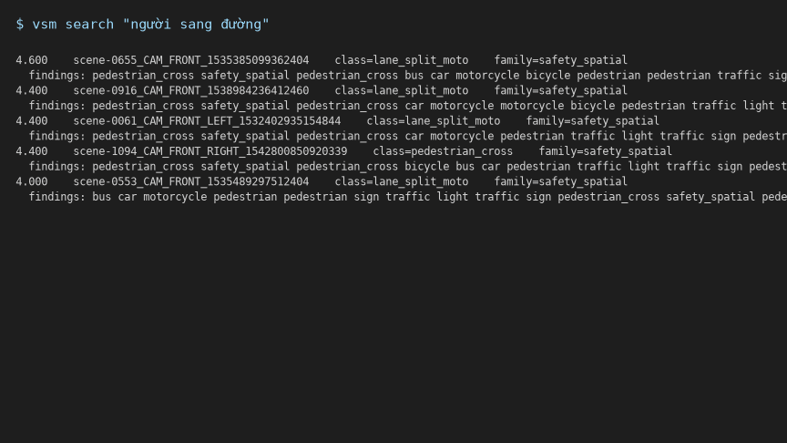

# VLM Scenario Mining

[](https://github.com/wuongg/vlm-scenario-mining/actions/workflows/ci.yml) [](LICENSE) [](pyproject.toml)

Three-stage labeling cascade over a frame-level index of driving data.

<!-- interpretation_gate: 1.0 -->

## T1 — TL;DR

A three-stage cascade (rules → detector → VLM) mines ADAS events from a frame-level index of driving data.



Detector event recall is **1.0** but box recall is 0.212 — the join rule is the story. Cost frontier: three $0 points. Eval is pre-registered: the headline cell was frozen before the official table. Every claim: [T2](#t2--one-page).

## T2 — One page

### Pitch

Three-stage cascade (T0 rules → open-vocab detector → VLM) over a frame-level index. Eval is **pre-registered**: the 8 load-bearing items were frozen before the official table (see [definition cards](docs/DEFINITION_CARDS.md)). Kill-switch **3/3**. Index headline = **45** ped_cross events.

### Capability manifest (capability-stratified)

9 transfer / 5 not / 1 partial — [`docs/CAPABILITY_MANIFEST.md`](docs/CAPABILITY_MANIFEST.md). Proven by the CODA cell below, not just listed.

| bucket | items |
|---|---|
| Transfer (9) | pre-reg eval; T0→detector→VLM; keyword index + negative-space; geometry fixture + join v2; kill-switch; $0 frontier; claim-audit; condition-breakdown; CODA-500 object table |
| Not (5) | fine-tune/LoRA; MCP; dense embedder; stacking/crop-verify; Platt calibration |
| Partial (1) | family-level routing skeleton (dummy confs; logprob stub) |

### Results (frozen)

Headline `{pedestrian_cross}` recall@tIoU=0.5 = **1.0** (10/10, detector = union). Precision **0.196**. API **0.3** / **0.75** on 4 claims — qualitative only (`n_pos<5`). Wilson **[0.72, 1.0]** on n_eff=10 is a conservative diagnostic; the honest statement is 10/10 on the 60-window grid, clustered by 10 scenes.

**Limitations.** Window-level matching saturates (all 10 TPs tIoU≥0.98). **3/10 TP are cross-camera time-overlap (LEFT↔RIGHT / LEFT↔FRONT) — window-level recall 1.0 does not claim same-camera identity.** Event-level tIoU needs finer GT windows. The join is the story: event R=1.0 / P=0.196 vs box-level VRU R=0.212 / P=0.440 (a note, not a fourth frontier point).

**Claim-audit (raw counts).** **GT-bounded hallucination** = 2/4 (false class on a GT window). **Unsupported claim rate** = 0/4 on GT-60 (corpus API not run). Two citations that claims need evidence: [0757 oscillation](results/0757_oscillation.json) and [logprob stub](results/logprob_stub.json) (API accepted `logprobs=True`, returned 1 dummy token vs 138).

**Frontier.** Three $0 points: detector (R=1.0, P=0.196) · API-GT60 (R=0.3, P=0.75) · union (R=1.0, P=0.196). **2-point frontier with a step at dummy confidences (0.75 / 0.85); per-class τ routing deferred to v1.1 (confidence source unavailable: logprob stub documented).** τ* spatial = **0.8** (U=0.367) is a **skeleton result, not a calibrated policy**.

CSV: [`headline_metrics.csv`](results/headline_metrics.csv) · [`cost_frontier.csv`](results/cost_frontier.csv) · [`coda_official.csv`](results/coda_official.csv)

### CODA — what transfers vs what does not

Cross-locale sanity (not a leaderboard): object-R **0.345** (387/1123) on 500/500 images.

| group | R |
|---|---|
| all | 0.345 |
| vru / vehicle | 0.784 / 0.762 |
| traffic_sign | 0.143 |
| barrier / cone / other / light | 0 (structural zero) |

| axis | gap |
|---|---|
| phrase-coverage | combined caption does not emit barrier/cone phrases — structural zero, documented |
| event-vs-object | CODA is object groups; mini headline is event ped_cross |
| geometry | map-ful join is mini-only; CODA has no nuScenes map |
| τ | frozen 0.30; not re-swept per distribution |
| resolution / prompts | 960×540 combined `{cls} .` vs paper per-phrase |

**Transfers:** schema, pre-reg eval, keyword index, kill-switch discipline. **Does not:** phrase coverage (barrier/cone), geometry (map-ful only), τ (per-distribution). That is the capability-stratified claim with a number on it.

### What I deliberately did not build

Fine-tune, LoRA, MCP, dense embedder, stacking / crop-verify, Platt calibration, video scrubber, dashboard, few-shot corpus. T0 is a rule layer, not a baseline. Fallback is CI-only, not a baseline. Routing is a P1 skeleton after the kill-switch.

### Rejected findings

Adversarial design review: **38 findings** in [`DECISIONS.md`](DECISIONS.md) (**26 ADOPTED**, **8 REJECTED**, **3 CASE**, **1 REPLACED**).

| rejected | why |
|---|---|
| video scrubber, dashboard, MCP, few-shot corpus | Day-1 gold-plate |
| torch on the default extra | CI stays CPU-only |
| 105-count 2D cut_in as n_pos | not T0, not a class label |
| redraw n=60 because scene-0061 is 15/60 | formula frozen |
| add `person .` | would retune the frozen τ sweep |
| corpus-API retry after canary freeze | D17 + D20, no retry |

### Data & Licensing

nuScenes mini, [CC BY-NC-SA 4.0](https://creativecommons.org/licenses/by-nc-sa/4.0/). Map v1.3 (Zenodo `10.5281/zenodo.15667707`). CODA-LM Test 500 + CODA2022-test images, research terms. Repo MIT; data licenses are not. Night on mini is hollandv-only.

## T3 — Docs

- `docs/DATA_SOURCE.md` · `docs/EVAL_PRE_REGISTRATION.md` · `docs/NEXT_STEPS.md`
- `docs/DEFINITION_CARDS.md` · `docs/CAPABILITY_MANIFEST.md` · `docs/SCRIPT_90S.md`
- `docs/OUTREACH.md` · `docs/REPO_COMPARE.md` · `docs/repo_design_v1.md`

## Reproduction

```bash
make install
make test
make lint
make assets
```

Frozen tags: [`v1.0`](https://github.com/wuongg/vlm-scenario-mining/releases/tag/v1.0) (eval) · [`v1.1-ROUTING-SKELETON`](https://github.com/wuongg/vlm-scenario-mining/releases/tag/v1.1-ROUTING-SKELETON) (routing wrap-up). T1 / GIF are presentation — no later tag.
